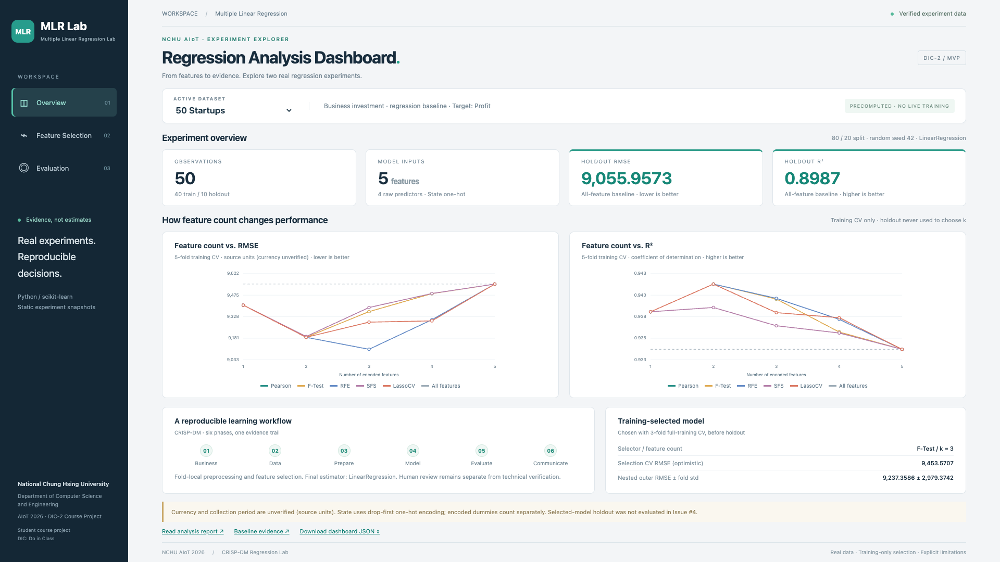

# AIoT DIC-2 — Multiple Linear Regression Lab

[](https://github.com/wupojung/AIoT-DIC2-MultipleLR/actions/workflows/pages.yml)
[](python/README.md)
[](https://github.com/wupojung/AIoT-DIC2-MultipleLR/actions)
[](tests/)

**English** · [繁體中文](README.zh-TW.md)

**NCHU AIoT 2026 · Do in Class 2** — A reproducible multiple linear regression and feature selection laboratory built with Python, scikit-learn, and the six-phase CRISP-DM methodology.

### Live demo

**[Open the GitHub Pages dashboard](https://wupojung.github.io/AIoT-DIC2-MultipleLR/)** · [Check deployment status](https://github.com/wupojung/AIoT-DIC2-MultipleLR/actions/workflows/pages.yml)

> **Live Dashboard MVP:** Switch between 50 Startups and Boston Housing across Overview, Feature Selection and Evaluation. All metrics, curves and feature ranks come from reviewed static experiment JSON. Custom Dataset now fits new CSV models locally; custom five-method Feature Selection is Not Available. Training CV, nested CV and holdout are explicitly separated.



[View Boston Housing](docs/assets/mlr-lab-boston_housing-overview-1920x1080.png) · [Branding screenshot evidence](docs/assets/BRANDING.md)

## Overview

This project studies **ordinary least squares (OLS) multiple linear regression**, reproducible evaluation, and feature selection. Experiments and charts come from actual Python executions; visualizations are not hand-filled with synthetic scores.

**What has been implemented**

- **50 Startups baseline:** A pinned, checksum-verified dataset; 80/20 train/test split; fold-local preprocessing; LinearRegression and a mean-prediction Dummy baseline; five-fold training CV and a frozen holdout evaluation.
- **Feature selection:** Pearson correlation, F-test, RFE, forward SFS, and LassoCV-based ranking, all evaluated with the same downstream LinearRegression model. Training-only CV and nested model-selection assessment prevent tuning on the holdout.
- **Reproducibility:** Source hashes, split identifiers, validation checks, recorded predictions, executable verification, and traceable reports.
- **Boston Housing:** Merged PR #17; pinned 506-row historical data, B excluded, baseline/dummy and five-method feature-selection evidence.
- **Dashboard MVP:** Real static results for both datasets, three tabs, locally rendered RMSE/R² curves and actual feature names/ranks. No external chart dependency.

**Deferred:** Custom CSV feature selection ([Issue #7](https://github.com/wupojung/AIoT-DIC2-MultipleLR/issues/7)), ADR-0002 and complete QA/coverage (Issue #8). The historic Boston dataset retains explicit ethical and licensing limitations.

## Verified experimental results

| Experiment | Measurement | Reported result |
| --- | --- | ---: |
| 50 Startups OLS baseline | Holdout R² | **0.898727** |
| 50 Startups OLS baseline | Holdout RMSE | **9,055.957** |
| Feature-selection procedure | Nested CV mean RMSE | **9,237.359** |
| Frozen training-based selection | Selected method and feature count | **F-Test, k=3** |

The holdout is **10 observations**. RMSE is in the source's numeric units; currency and reporting period are unverified. Nested CV figures are **not** new independent holdout scores. See the [baseline report](docs/reports/50_startups/report.md), [feature selection report](docs/reports/feature_selection/REPORT.md), and [evaluation protocol](docs/EVALUATION_PROTOCOL.md).

## Engineering quality and deployment

| Check | Current status | Evidence |
| --- | --- | --- |
| GitHub Pages deployment | GitHub Actions workflow is configured; live status must be checked | [Pages workflow](https://github.com/wupojung/AIoT-DIC2-MultipleLR/actions/workflows/pages.yml) |
| Python / browser checks | Local tests and verification scripts exist; no dedicated CI workflow yet | [Tests](tests/) · [Verification reports](docs/reports/) |
| Test coverage | Not yet measured; **no percentage claimed** | [Tests](tests/) |
| Research provenance | Pinned dataset, stored metadata, fold isolation and reproducibility checks | [Data policy](data/README.md) · [Reports](docs/reports/) |

A green deployment badge indicates the GitHub Pages workflow result, **not** that the regression backend or CSV analysis is working. The existing `.github/workflows/pages.yml` deploys the `web/` directory; README-only changes do **not** trigger its current path-filtered workflow.

## CRISP-DM workflow

| Phase | Purpose |
| --- | --- |
| 1. Business Understanding | Define the target, scope, and research limitations |
| 2. Data Understanding | Check provenance, schema, statistics, and data quality |
| 3. Data Preparation | Split data and apply training-only preprocessing |
| 4. Modeling | Run OLS, dummy baseline, and cross-validation |
| 5. Evaluation | Report MAE, MSE, RMSE, R², diagnostics, and feature selection |
| 6. Deployment | Publish reproducible results and progressively develop the UI |

**Research integrity:** All selectors are fitted inside the relevant training folds. Reported charts are generated from actual runs. Do not choose features using holdout results or compare RMSE directly across datasets with different target units.

## Quick start

Requires Python **3.12+** and a browser. Dependencies and version constraints are documented in [requirements.txt](requirements.txt) and [constraints.txt](constraints.txt).

```sh
git clone https://github.com/wupojung/AIoT-DIC2-MultipleLR.git
cd AIoT-DIC2-MultipleLR
python3 -m venv .venv
source .venv/bin/activate
python -m pip install -r requirements.txt
python python/src/environment_check.py
python python/src/startups_baseline.py --run-id baseline-v1
python -m unittest discover -s tests -v
python -m http.server 8000 --directory web
```

Open <http://localhost:8000/> to preview the static UI. The baseline downloads the **pinned and SHA-256 verified** teaching CSV on its first run; generated outputs are excluded from Git. For feature selection execution and validation, follow the [reproduction instructions](docs/reports/feature_selection/REPORT.md). See [Python instructions](python/README.md) for other operating systems.

## Public CSV examples — Custom Regression MVP

The following public files are **candidate regression inputs** for testing the future import feature; **the current website cannot analyze them yet**. Users will need to select a numeric target and suitable feature columns, handle missing/categorical values, and fit the new dataset from scratch.

| Dataset | CSV | Suggested target | Suggested predictors | Caveat |
| --- | --- | --- | --- | --- |
| 50 Startups | [CSV](https://raw.githubusercontent.com/Avik-Jain/100-Days-Of-ML-Code/master/datasets/50_Startups.csv) | `Profit` | `R&D Spend`, `Administration`, `Marketing Spend`, `State` | `State` requires encoding; small sample |
| Auto MPG | [CSV](https://raw.githubusercontent.com/mwaskom/seaborn-data/master/mpg.csv) | `mpg` | `cylinders`, `displacement`, `horsepower`, `weight`, `acceleration` | Missing horsepower values |
| Restaurant Tips | [CSV](https://raw.githubusercontent.com/plotly/datasets/master/tips.csv) | `tip` | `total_bill`, `size` | Other categorical fields need encoding; no causal claim |

CSV URL downloads may be blocked by **CORS**, authentication, or source restrictions. Local file upload is available as a fallback. Arbitrary CSVs are not guaranteed to be valid regression datasets; feature/target types, sample count, dependence, leakage, and source rights require checking.

## Documentation and references

- **Research:** [CRISP-DM](docs/CRISP_DM.md) · [Feature-selection protocol](docs/FEATURE_SELECTION_PROTOCOL.md) · [Evaluation protocol](docs/EVALUATION_PROTOCOL.md) · [Workflow reuse](docs/WORKFLOW_REUSE.md)
- **Architecture:** [Architecture](docs/ARCHITECTURE.md) · [ADR-0001 (Accepted)](docs/adr/ADR-0001-project-foundation.md) · [ADR index](docs/adr/README.md) · [ADR-0002 proposal](https://github.com/wupojung/AIoT-DIC2-MultipleLR/pull/12)
- **Data:** [Dataset definitions and ethics](docs/PROBLEM_DEFINITIONS.md) · [Data policy](data/README.md) · [Glossary](docs/GLOSSARY.md)
- **Project:** [Issues](https://github.com/wupojung/AIoT-DIC2-MultipleLR/issues) · [Course reference by Professor Huan Chen](https://github.com/huanchen1107/AIoT-DIC2-MultipleLR) · [Previous experiment](https://github.com/wupojung/DIC-2_test)
- **UI inspiration:** [StatsUnlock multiple regression calculator](https://statsunlock.com/multiple-linear-regression-calculator/)

**Development process:** Codex works in feature branches and follows **BUILD → RUN → TEST → VERIFY → PASS**. Pull requests require manual review and explicit approval before merging. The assignment's final submission requirements and historical source limitations remain subject to instructor confirmation.

## Boston Housing MVP — Issue #5

[繁中分析報告與 RMSE/R² 圖](docs/reports/boston_housing/REPORT.md) · [實測驗證](docs/reports/boston_housing/VERIFICATION.md) · [來源與倫理政策](docs/BOSTON_WORKFLOW_PROPOSAL.md)

```sh
python python/src/boston_workflow.py --run-id boston-v1
python python/src/verify_boston_run.py outputs/boston_housing/boston-v1
```

Pinned historical CSV，506 rows；B 排除後 12 predictors，MEDV（歷史千美元）。
重用共通 Regression／五種 Feature Selection；原始資料不隨 repo 散布。
Owner-authorized educational MVP; original dataset rights and instructor acceptance remain limitations. Issue #6 now presents these actual experiment snapshots in Web.

## Dashboard MVP reproduction — no model rerun

```sh
python3 python/src/export_dashboard.py --check
python3 -m http.server 8000 --directory web
# External development Playwright installation:
NODE_PATH=/tmp/dic2-browser/node_modules node tests/dashboard_smoke.cjs
```

Open http://localhost:8000/. No ML dependency installation or nested CV is needed to display the accepted results.
The export check traces both static payloads to reviewed source JSON and SHA256 lineage.
1920×1080 browser verification checks dataset round trips, three tabs, exact metrics, every curve coordinate, ranks and console/network errors.
[Actual results and deployment evidence](docs/assets/README.md). Full Python regressions, five-size browser matrix and coverage were intentionally not rerun for this urgent MVP.

## Custom CSV Regression MVP — Issue #7

Local CSV / public CORS-enabled URL → choose Y and 2+ X → fresh browser OLS + Dummy, predictions, residuals and metrics.
[操作與限制 / Usage and limits](docs/CUSTOM_CSV.md) · [PoC、sklearn 對照與正式截圖](docs/reports/custom_csv/REPORT.md).
Custom feature ranking/k-curves remain **Not Available**; no static result is substituted. No Vercel/backend; ADR-0002 remains Proposed.
