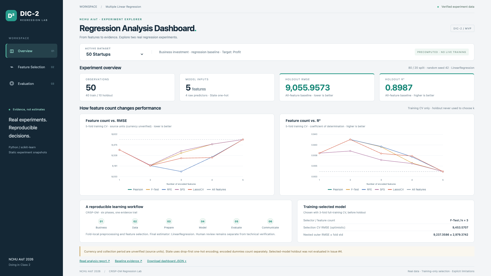

# AIoT DIC-2 — 多元線性迴歸實驗室

[](https://github.com/wupojung/AIoT-DIC2-MultipleLR/actions/workflows/pages.yml)
[](python/README.md)
[](https://github.com/wupojung/AIoT-DIC2-MultipleLR/actions)
[](tests/)

[English](README.md) · **繁體中文**

**國立中興大學 AIoT 2026 · Doing in Class 2**

本專案以 Python、scikit-learn 及 **CRISP-DM 六階段**，實作多元線性迴歸（Multiple Linear Regression）、特徵選擇（Feature Selection）與可重現的模型評估。所有研究指標與圖表均來自實際程式執行，不使用硬編碼分數冒充分析。

## Live Demo／網站預覽

**[開啟 GitHub Pages Demo](https://wupojung.github.io/AIoT-DIC2-MultipleLR/)** · [檢查部署紀錄](https://github.com/wupojung/AIoT-DIC2-MultipleLR/actions/workflows/pages.yml)

> **Dashboard MVP 已串接真實實測結果**：50 Startups／Boston Housing 下拉切換，Overview／Feature Selection／Evaluation 三頁，顯示 RMSE／R²、曲線、特徵順序及評估表。讀取靜態 JSON，沒有即時訓練或自訂 CSV；Training CV、Nested CV、Holdout 明確分開。



[Boston Housing 截圖](docs/assets/dashboard-boston_housing-overview-1920x1080.png) · [六張正式截圖與驗證證據](docs/assets/README.md)

## 專案功能與進度

| 模組 | 狀態 | 證據 |
| --- | --- | --- |
| 50 Startups Baseline | 已完成（Issue #3／PR #14） | [實測報告與六張圖](docs/reports/50_startups/report.md) |
| 五種 Feature Selection | 已完成（Issue #4／PR #15） | [比較分析及 RMSE／R² 曲線](docs/reports/feature_selection/REPORT.md) |
| Boston Housing Workflow Reuse | PR #17 已合併，技術實測完成 | [Issue #5](https://github.com/wupojung/AIoT-DIC2-MultipleLR/issues/5) |
| Web Dashboard | 真實結果雙資料集三頁 MVP | [Web 說明](web/README.md) |
| 自訂 CSV Dataset | 尚未實作 | [Issue #7](https://github.com/wupojung/AIoT-DIC2-MultipleLR/issues/7) · [ADR-0002 草案](https://github.com/wupojung/AIoT-DIC2-MultipleLR/pull/12) |

50 Startups 採固定資料來源與 SHA-256、80/20 訓練測試切分、fold-local 前處理、五折訓練 CV、OLS LinearRegression 與 Dummy Baseline。Feature Selection 使用 **Pearson、F-Test、RFE、Forward SFS、LassoCV**，並以統一 OLS 下游模型公平比較；另以 Nested CV 檢查選模偏差。

## 實測研究結果

| 實驗 | 指標 | 數值 |
| --- | --- | ---: |
| 50 Startups Baseline | Holdout R² | **0.898727** |
| 50 Startups Baseline | Holdout RMSE | **9,055.957** |
| Feature Selection | Nested CV mean RMSE | **9,237.359** |
| Feature Selection | 完整訓練集凍結選擇 | **F-Test，k=3** |

Baseline holdout 只有 **10 筆**；RMSE 使用原始資料數值單位，貨幣與期間尚未確認。Nested CV 不是新的獨立測試集結果。請參考 [Baseline 報告](docs/reports/50_startups/report.md)、[特徵選擇報告](docs/reports/feature_selection/REPORT.md) 與 [評估協定](docs/EVALUATION_PROTOCOL.md)。不同資料集的 RMSE 不可忽略單位直接比較。

## GitHub Actions、CI/CD 與 Coverage

| 機制 | 實際狀況 |
| --- | --- |
| **CD — GitHub Pages** | 已有 `.github/workflows/pages.yml`；是否成功部署以 [Actions](https://github.com/wupojung/AIoT-DIC2-MultipleLR/actions/workflows/pages.yml) 為準 |
| **CI — 自動化測試** | 本地測試與 Verifier 已建立，但尚未配置獨立 GitHub CI Workflow |
| **Test Coverage** | 尚未量測，不能宣稱覆蓋率百分比 |
| **研究驗證** | PR 提供 BUILD → RUN → TEST → VERIFY → PASS，保留資料來源與預測追溯證據 |

Pages Workflow 目前只有 `main` 上的 `web/**` 或 Workflow 檔案變更才會自動觸發；README 更新不會自動部署。Coverage 是程式測試覆蓋率，**不是 R² 或模型準確率**。

## CRISP-DM 六階段

| 階段 | 重點 |
| --- | --- |
| 1. Business Understanding | 定義問題、預測目標、限制 |
| 2. Data Understanding | 資料來源、Schema、EDA、品質 |
| 3. Data Preparation | 切分、缺值處理、編碼、避免資料洩漏 |
| 4. Modeling | LinearRegression、Dummy、Cross-Validation |
| 5. Evaluation | MAE、MSE、RMSE、R²、殘差、特徵選擇 |
| 6. Deployment | 報告、可重現產物、網站展示（靜態實測結果展示） |

## 本地快速啟動

需要 Python **3.12+**（曾在 Python 3.14.2 測試），依 [requirements.txt](requirements.txt) 與 [constraints.txt](constraints.txt) 安裝套件。

```sh
git clone https://github.com/wupojung/AIoT-DIC2-MultipleLR.git
cd AIoT-DIC2-MultipleLR
python3 -m venv .venv
source .venv/bin/activate
python -m pip install -r requirements.txt
python python/src/environment_check.py
python python/src/startups_baseline.py --run-id baseline-v1
python -m unittest discover -s tests -v
python -m http.server 8000 --directory web
```

開啟 <http://localhost:8000/> 檢視靜態 UI。首次分析會下載並驗證固定來源的 50 Startups CSV；產物位於被 Git 忽略的 `outputs/`。特徵選擇重現指令見 [分析報告](docs/reports/feature_selection/REPORT.md)，其他作業系統見 [Python 說明](python/README.md)。

## 自訂 CSV 測試範例（規劃功能）

以下均為公開可取得的**候選資料集**，不代表目前網頁可以立即輸入並分析。未來每次匯入都必須重新指定數值型 Target（y）與可用 Features（X），並重新執行前處理、訓練和評估。

| Dataset | CSV | Target（y） | 建議 Features（X） | 注意事項 |
| --- | --- | --- | --- | --- |
| 50 Startups | [下載](https://raw.githubusercontent.com/Avik-Jain/100-Days-Of-ML-Code/master/datasets/50_Startups.csv) | `Profit` | R&D Spend、Administration、Marketing Spend、State | State 需編碼，小樣本 |
| Auto MPG | [下載](https://raw.githubusercontent.com/mwaskom/seaborn-data/master/mpg.csv) | `mpg` | cylinders、displacement、horsepower、weight、acceleration | horsepower 有缺值 |
| Restaurant Tips | [下載](https://raw.githubusercontent.com/plotly/datasets/master/tips.csv) | `tip` | total_bill、size | 其他類別欄位需編碼，不作因果推論 |

CSV URL 可能受到 CORS、驗證或授權限制；本機 CSV 上傳只是尚待實作的替代設計。**並非任何 CSV 都能直接進行多元線性迴歸**，仍需檢查資料型別、有效樣本數、獨立性與資料洩漏。課堂「14–39 Features」提示是否為正式條件尚待教師確認。

## 架構、文件與參考

- [CRISP-DM](docs/CRISP_DM.md) · [Evaluation Protocol](docs/EVALUATION_PROTOCOL.md) · [Feature Selection Protocol](docs/FEATURE_SELECTION_PROTOCOL.md) · [Workflow Reuse](docs/WORKFLOW_REUSE.md)
- [Architecture](docs/ARCHITECTURE.md) · [ADR-0001（Accepted）](docs/adr/ADR-0001-project-foundation.md) · [ADR index](docs/adr/README.md) · [ADR-0002（Proposed）](https://github.com/wupojung/AIoT-DIC2-MultipleLR/pull/12)
- [資料集定義與倫理](docs/PROBLEM_DEFINITIONS.md) · [資料政策](data/README.md) · [術語表](docs/GLOSSARY.md)
- [GitHub Issues](https://github.com/wupojung/AIoT-DIC2-MultipleLR/issues) · [陳煥教授參考專案](https://github.com/huanchen1107/AIoT-DIC2-MultipleLR) · [舊版實驗](https://github.com/wupojung/DIC-2_test) · [StatsUnlock 設計參考](https://statsunlock.com/multiple-linear-regression-calculator/)

本專案由 Codex 依獨立分支開發，遵守 **BUILD → RUN → TEST → VERIFY → PASS**，所有 PR 經人工 Review、明確授權才 Merge。歷史資料權利、貨幣單位及教師未決要求不得假設已確認。

## Boston Housing MVP — Issue #5

[繁中分析報告與 RMSE/R² 圖](docs/reports/boston_housing/REPORT.md) · [實測驗證](docs/reports/boston_housing/VERIFICATION.md) · [來源與倫理政策](docs/BOSTON_WORKFLOW_PROPOSAL.md)

```sh
python python/src/boston_workflow.py --run-id boston-v1
python python/src/verify_boston_run.py outputs/boston_housing/boston-v1
```

Pinned historical CSV，506 rows；B 排除後 12 predictors，MEDV（歷史千美元）。
重用共通 Regression／五種 Feature Selection；原始資料不隨 repo 散布。
Owner 暫准教學 MVP，不代表原始授權或教師審查已完成；Issue #6 已在 Web 展示這些實測產物。

## Dashboard MVP 重現（不重跑模型）

```sh
python3 python/src/export_dashboard.py --check
python3 -m http.server 8000 --directory web
NODE_PATH=/tmp/dic2-browser/node_modules node tests/dashboard_smoke.cjs
```

瀏覽 http://localhost:8000/，不需要安裝 ML 相依或重跑 Nested CV。
匯出檢查會比對靜態 JSON 與實測來源，含 SHA256 追溯。1920×1080 實際瀏覽器檢查資料集往返切換、
三頁、精確指標、每個圖表座標、排名及 console/network errors。
[實際結果與部署證據](docs/assets/README.md)。本次刻意不重跑完整 Python／五尺寸矩陣／Coverage；
Custom CSV、ADR-0002、CI 建置與非必要重構暫停。
