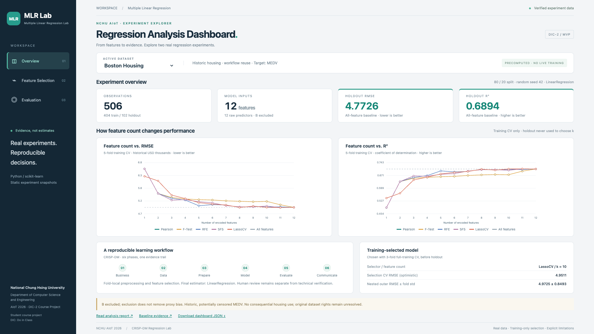

# MLR Lab — real public-site screenshots

**Minimal branding verification: PASS. Human review pending.**

- Public URL: https://wupojung.github.io/AIoT-DIC2-MultipleLR/
- Deployed Web commit: **`48c41b83143bff8a53ecdb3780f2db6924f994d3`**.
- [Successful GitHub Pages deployment](https://github.com/wupojung/AIoT-DIC2-MultipleLR/actions/runs/38925143973).
- Independent branch `fix/mlr-lab-branding`, from latest main `1cc1e3f` after PR #20 merged.
- Later commits attach evidence and update README screenshot links only; deployed HTML/CSS remain exactly the commit above.

Both PNGs are actual **Playwright + Google Chrome** captures from the public URL, viewport **1920×1080**, device scale 1, viewport capture. No image generation, mockups or compositing.
Browser version, capture timestamp, deployed asset SHA256 and scenario results: [machine-readable evidence](mlr-lab-branding-verification.json).

## 50 Startups — Overview


## Boston Housing — Overview



## Actual checks

- HTTP 200 and byte equality for deployed index.html, styles.css, unchanged app.js and both unchanged dataset JSONs against the branch.
- Sidebar: MLR / MLR Lab / Multiple Linear Regression Lab; full school/department/course attribution visible within the 1080p viewport.
- Attribution explicitly says **Student course project** and **DIC: Do in Class**; it does not claim departmental certification or endorsement.
- 50 Startups → Boston Housing → 50 Startups, all three analysis pages: **9/9 scenarios PASS**.
- Overview RMSE/R² checked against original experiment JSON; Evaluation table RMSE/R² checked for each displayed model. Startup selected-model holdout remains explicitly not evaluated.
- Baseline display spot checks: Startups **9,055.9573 / 0.8987**; Boston **4.7726 / 0.6894**. No experiment data changed.
- Nonempty charts, no desktop horizontal overflow, no failed HTTP/network requests, **0 Console/JavaScript errors**. Two PNG dimensions confirmed exactly 1920×1080; screenshots visually inspected.
- Initial asset check during deployment correctly detected the previous public version; it was not accepted as evidence. Final check and captures were made after successful deployment and exact asset matching.

Actual deployment/browser commands:

```sh
gh workflow run pages.yml --ref fix/mlr-lab-branding
gh run watch 38925143973 --exit-status --interval 5
NODE_PATH=/tmp/dic2-browser/node_modules node /tmp/mlr-branding-smoke.cjs
git diff origin/main HEAD --check
git diff origin/main HEAD -- python data web/app.js web/data docs/reports docs/adr .github
```

The temporary Playwright script performed the checks above, using the installed real Google Chrome executable at `/Applications/Google Chrome.app/Contents/MacOS/Google Chrome`; it did not generate or modify experiment data.
To deploy without merging, this exact review branch was added to the existing `github-pages` environment allowlist; main's policy and deployment workflow are unchanged.

Scope: only website branding/footer/title and CSS alignment, minimal README terminology/screenshot-link corrections, two captures and this evidence. Python, regression/feature-selection code, JSON/CSV experiments and deployment workflow are unchanged.
No regression, nested CV, complete viewport matrix or coverage rerun. No auto-merge or issue closure.
