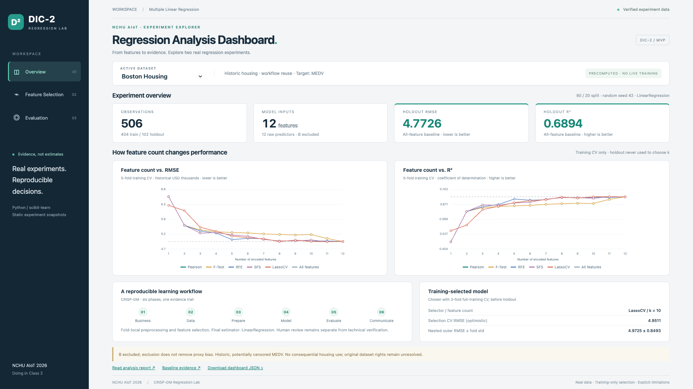

# Dashboard MVP — Desktop screenshots & verification

**Issue #6 minimal technical verification: PASS. Human review pending.**

[Live GitHub Pages](https://wupojung.github.io/AIoT-DIC2-MultipleLR/) · [Successful deployment](https://github.com/wupojung/AIoT-DIC2-MultipleLR/actions/runs/38922135144)

PR #17 was confirmed merged at `2026-10-16T15:06:12Z`. Work starts from latest main `521f6c4` on independent branch `dic2-06-dashboard-mvp`.
The public site serves this review branch's Web commit `16bd349c80417fe1a7f89b3acd77a7d4d24ebb1f`, using the existing Pages workflow. No PR was merged by this work.
Only the exact feature branch was added to the `github-pages` environment's deployment allowlist; main's existing policy and workflow remain intact.
The preview can later be replaced by a normal main deployment. [Published asset hashes](deployed-assets.json) confirm HTTP 200 and byte equality for index.html, app.js, styles.css and both dataset JSONs.

## Actual browser captures

All six PNGs below were captured from the **public Pages URL**, using real Playwright + Google Chrome at a **1920×1080 viewport**, device scale 1. No AI-generated images or mockups.
Overview and Evaluation are exactly 1920×1080; Feature Selection uses full-page capture to include every ranking row (height may exceed 1080).

| Dataset | Overview | Feature Selection | Evaluation |
| --- | --- | --- | --- |
| 50 Startups | [Screenshot](dashboard-50_startups-overview-1920x1080.png) | [Screenshot](dashboard-50_startups-features-1920x1080.png) | [Screenshot](dashboard-50_startups-evaluation-1920x1080.png) |
| Boston Housing | [Screenshot](dashboard-boston_housing-overview-1920x1080.png) | [Screenshot](dashboard-boston_housing-features-1920x1080.png) | [Screenshot](dashboard-boston_housing-evaluation-1920x1080.png) |




## BUILD → RUN → TEST → VERIFY → MVP PASS

No bundler/build dependencies. Standard-library-only static export; **no training or nested CV executed**.

```sh
# BUILD: export existing reviewed metrics, check deterministic source equality
python3 python/src/export_dashboard.py
python3 python/src/export_dashboard.py --check
# RUN: serve the static Web locally
python3 -m http.server 8000 --directory web
# TEST: existing external Playwright + local Google Chrome
NODE_PATH=/tmp/dic2-browser/node_modules node tests/dashboard_smoke.cjs
# Deploy the explicitly authorized review branch using existing workflow
gh workflow run pages.yml --ref dic2-06-dashboard-mvp
gh run watch 38922135144 --exit-status --interval 5
# VERIFY: repeat the browser checks and capture the deployed site
DASHBOARD_URL=https://wupojung.github.io/AIoT-DIC2-MultipleLR/ NODE_PATH=/tmp/dic2-browser/node_modules node tests/dashboard_smoke.cjs
git diff origin/main HEAD --check
```

- Three lightweight foundation/environment/document-link tests also **PASS** (0.042s); no ML analysis executed.
- Static source/export check **PASS for both datasets**; every export retains original report paths and SHA256 lineage. An additional direct comparison against original report JSON confirmed curve arrays, frozen choices and baseline/selected holdout values, including absence of selected holdout for Startups.
- Local and public browser runs each **9/9 scenarios PASS**: 50 Startups → Boston → 50 Startups, all three tabs. Dataset JSON is loaded successfully and equals the local export.
- All displayed holdout MAE/MSE/RMSE/R² table values and headline baseline values match source-rounded values; training CV RMSE also checked.
- Both RMSE/R² charts are nonempty. Every plotted method/k coordinate is compared against JSON-derived expectations; all five ranking tables match actual full-training orders. Switching back resets all panels.
- Desktop horizontal overflow and keyboard tab navigation checked. Public browser JavaScript/Console errors and failed HTTP/network requests: **0**.
- Pages deployment **SUCCESS**, 44s. Existing Actions runtime-deprecation/runner-image notices are nonblocking; workflow was not rewritten.
- Six formal screenshots generated; [machine-readable browser evidence](dashboard-verification.json), [deployed asset hashes](deployed-assets.json).
- Original experiments, frozen evaluation protocols, accepted ADRs, ML source and workflow/dependency files are unchanged. No raw dataset or model artifacts are published; Pages still uploads only web/.

### Metric spot checks (actual source values, displayed rounded)

| Dataset / assessment | RMSE | R² |
| --- | ---: | ---: |
| 50 Startups / holdout All Features | 9055.9573 | 0.8987 |
| 50 Startups / holdout Dummy | 33776.6915 | -0.4088 |
| Boston Housing / holdout All Features | 4.7726 | 0.6894 |
| Boston Housing / holdout Selected | 4.7618 | 0.6908 |
| Boston Housing / holdout Dummy | 8.6629 | -0.0233 |

Startups uses unverified source currency/period; Boston MEDV uses historical USD thousands. RMSE is not comparable across these units.
Startups feature selection remains training-only; the UI explicitly marks selected-model holdout **not evaluated**. Baseline holdout is from Issue #3.
Boston B is excluded; proxy bias, historic/censored data and original dataset rights remain limitations. Nested CV is never labeled as holdout.

## Explicitly deferred / not claimed

No complete Python regression rerun, nested CV, five-size browser matrix, cross-platform QA or coverage was performed in Issue #6.
No Custom CSV, ADR-0002, CI build, backend model service, automatic experiment rerun or unrelated refactor. The previous foundation browser script expects a disabled dataset selector and was not run or claimed passing; `dashboard_smoke.cjs` verifies the current MVP contract.
The static JSON contract and its exporter are documented in [Web guide](../../web/README.md).
Do not self-merge or close Issue #6. Technical MVP PASS is scoped to the checks above and does not replace human acceptance.
