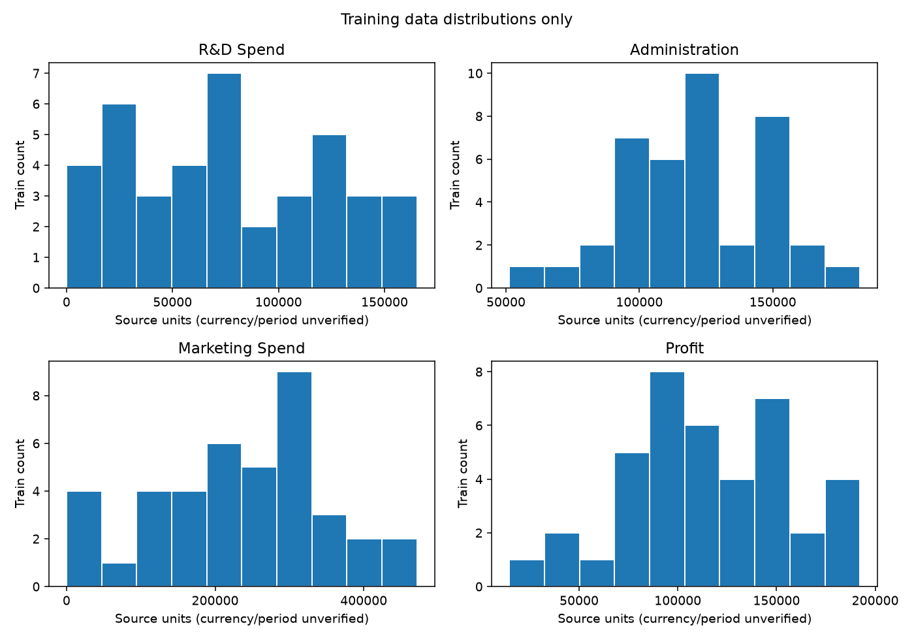
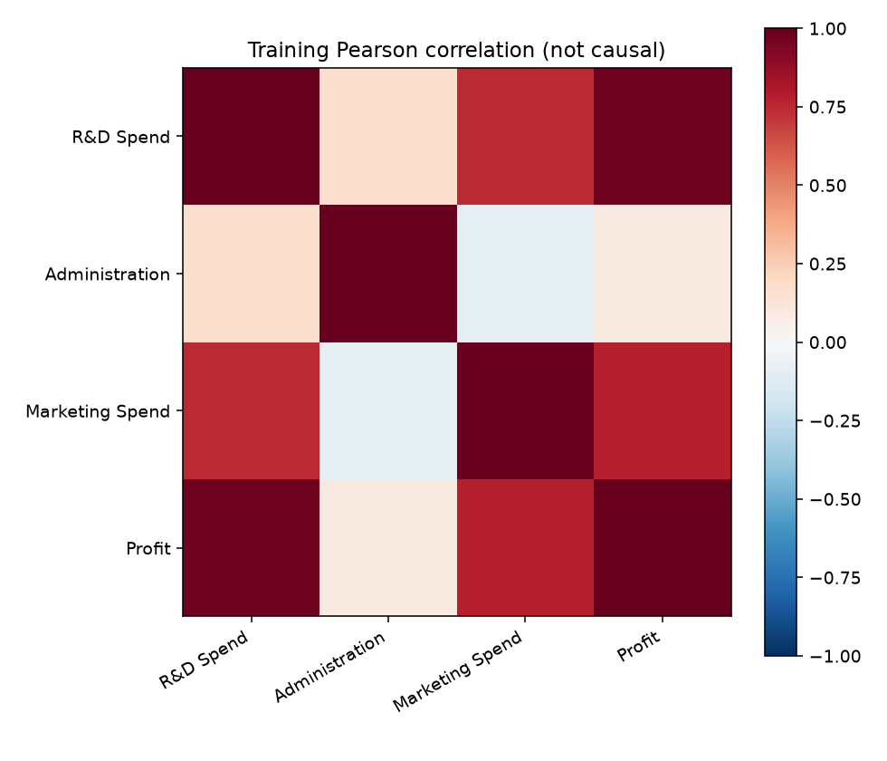
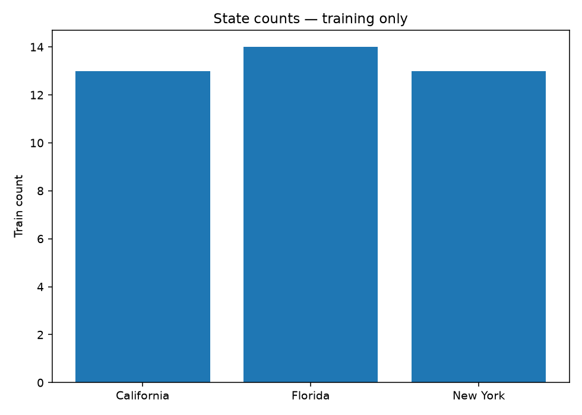
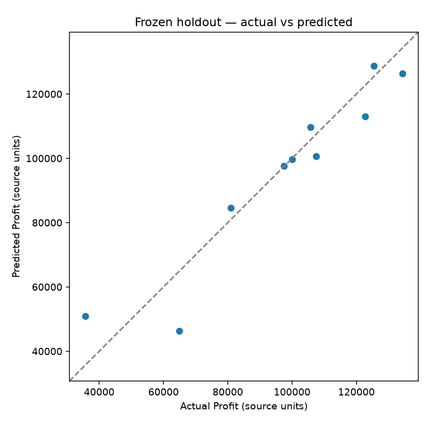
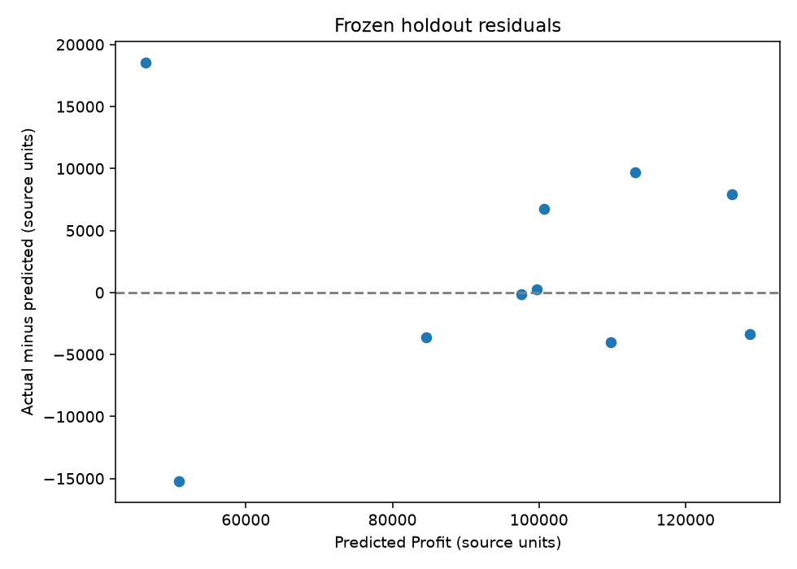
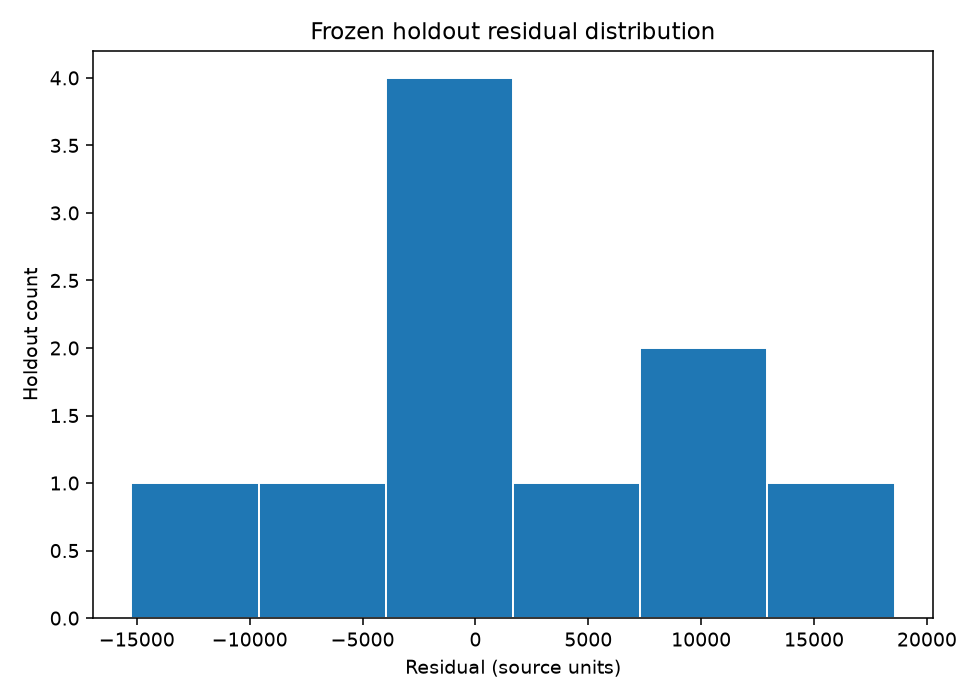

# 50 Startups baseline — Review evidence

Status: **technical verification complete; human CRISP-DM phase review pending**.
Owner requested Issue #3 after merging PR #11 and closing Issue #2. This report
records a fixed baseline, not model selection, causal evidence or production readiness.

## Source and method

- Pinned CSV revision: `5d67810c1498082e7bb262cf6397d7861dfd9891`; [source](https://raw.githubusercontent.com/Avik-Jain/100-Days-Of-ML-Code/5d67810c1498082e7bb262cf6397d7861dfd9891/datasets/50_Startups.csv).
- SHA-256: `c6075ca5a7551243b31193bad9228f0a1b9468cdde2475c6586c56dcfac5630d`.
- Download record UTC: 2026-10-16T13:27:42.334444+00:00.
- Measured: 50 rows, four raw predictors and Profit; missing values 0, duplicate rows 0, duplicate predictor groups 0.
- Four raw inputs: R&D Spend, Administration, Marketing Spend, State. State
  one-hot drop-first yields five columns in this training fit (three observed
  categories); counts are exported per fold, not assumed from the full dataset.
- Seed 42, shuffled 80/20 split (40/10), shuffled five-fold training CV.
  Median/mode imputation and encoding fit separately in each fold. No feature
  selection, tuning, seed search or comparison against teacher scores.
- Predeclared full LinearRegression plus training-mean Dummy. Frozen method
  before one holdout prediction per estimator per run. Repeated runs only check
  reproducibility. Reported CV std uses ddof=0; RMSE mean is mean of fold RMSE.

## Measured metrics

Errors use **unverified source numerical units**, MSE uses squared units. R² has
no unit. CV refers to training validation folds; holdout has only ten observations.

| Partition / estimator | MAE | MSE | RMSE | R² |
| --- | --- | --- | --- | --- |
| Train CV / LinearRegression (mean ± std) | 7425.881525 ± 1768.296714 | 99836230.642777 ± 63996948.643599 | 9550.676106 ± 2936.122710 | 0.934004 ± 0.032301 |
| Holdout / LinearRegression | 6961.477813 | 82010363.044301 | 9055.957323 | 0.898727 |
| Train CV / Dummy mean (mean ± std) | 35067.191750 ± 4543.615883 | 1812813144.647297 ± 410085814.326252 | 42258.498778 ± 5199.271647 | -0.241876 ± 0.236690 |
| Holdout / Dummy mean | 25295.290200 | 1140864891.396847 | 33776.691540 | -0.408837 |

[Exact exported metrics](metrics.json). Unknown State count was zero in each CV
validation fold and holdout. The code records unknowns as all-zero/reference
ambiguity rather than treating that as a new learned category.

LinearRegression improves on the mean predictor in this fixed split, but ten test
rows give limited evidence. CV dispersion and test error must be considered;
this report does not claim a universal best model or feature subset.

## Actual generated figures

All six figures below were produced by matplotlib from the actual execution.
Training plots are separate from holdout diagnostics; these are not mockups.








## Reproduce and verify

See [Python setup](../../../python/README.md). From repository root:
```sh
python python/src/startups_baseline.py --run-id baseline-v1
python python/src/verify_startups_run.py outputs/50_startups/baseline-v1 --source data/50_startups/50_Startups.csv
python -m unittest discover -s tests -v
```
Choose a fresh run-id; overwriting is refused. The first command needs network
unless a verified cache exists. The full local outputs include split/fold IDs,
training medians/categories, predictions, coefficients, config, source retrieval
and package versions. Raw CSV and fitted model artifacts are not committed.

## Limits and phase status

The mirror repository provides an MIT notice (2018 Avik Jain); original collection
and dataset-specific rights are not independently established. Currency, reporting
period and independent-company sampling cannot be verified from this CSV. This is
a local teaching analysis; no original-data redistribution or causal inference.
No model comparisons were chosen after seeing holdout performance. Cross-platform
floating-point/plot pixel differences are possible despite pinned dependencies.

Phase 1–5 have execution evidence but remain Work in progress pending human review;
Phase 6 local reproduction/report is available, final course submission is planned.
Q1–Q5 in the [requirement matrix](../../ASSIGNMENT_REQUIREMENTS.md) remain open;
no instructor approval is inferred. Boston, feature selection, API, Web data
integration, arbitrary CSV and deployment are outside Issue #3.
