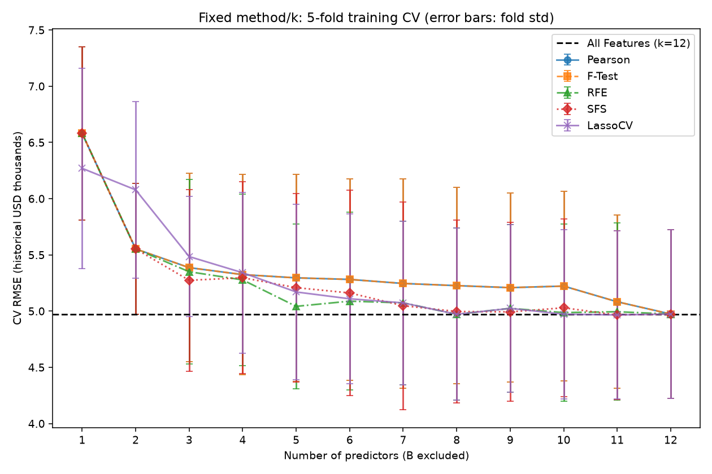
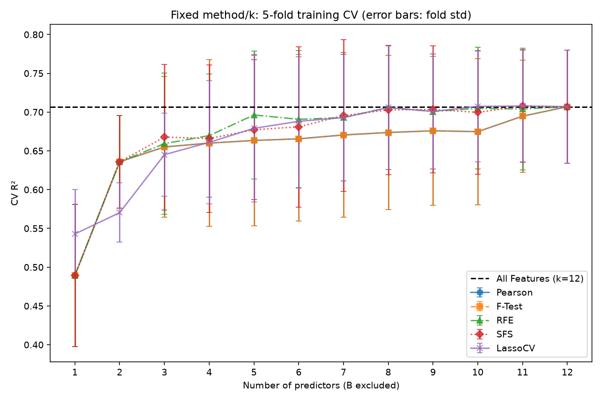

# Boston Housing — CRISP-DM 實測報告

本報告由實際執行產生。技術驗證與人工／教師接受分開；尚待人工 Review。

## 1. 商業理解

以歷史地區聚合資料預測 MEDV（歷史千美元），驗證流程重用。不得用於現代住房決策，亦不宣稱因果關係。

## 2. 資料理解

來源、版本、SHA256 與權利限制見 [provenance.json](provenance.json)；欄位說明見 [來源與政策](https://github.com/wupojung/AIoT-DIC2-MultipleLR/blob/dic2-05-boston-workflow/docs/BOSTON_WORKFLOW_PROPOSAL.md)。
506 筆、13 原始 predictors + MEDV；排除 B 後 12 個。完整結構稽核見 [data_quality.json](data_quality.json)。
B 是歷史種族比例的非線性變換；排除不代表移除代理偏誤。LSTAT 等仍具社經偏誤。
原始資料專屬授權與來源權利尚未完全釐清；owner 暫准本地教學評估，不代表教師核准或新授權；不散布原始 CSV。

## 3. 資料準備

seed=42，404 train / 102 holdout；不沿用 Startups row IDs。來源沒有可用地理群組 ID，僅評估歷史隨機樣本，不能外推空間泛化。
CHAS 保持二元數值；RAD 保持來源的數值索引；無 State/OHE。每個相關 training fold 重擬合補值／尺度及選擇器。

## 4. 建模

共用 regression_workflow 與 feature_selection.training_experiment；五方法實際執行，最終預測器皆 LinearRegression。
外層 5 折比較固定方法/k；內層 3 折選擇；SFS/Lasso 各自再有 fold-local 3 折。
LassoCV 固定 21 個 alpha（1e-4..1e2）；按局部 CV 最小 mean MSE 選 alpha，同分取較大 alpha；重擬合後依標準化係數絕對值降序、同分依欄名。零係數仍明示在排名尾端，k 可納入。
Pearson 依 abs(r)、F-Test 依 F 值、RFE 依逆淘汰順序（非前向加入）、SFS 依真正貪婪進入順序。所有 context 的完整順序與每個 k 集合見 selected_features.csv。

## 5. 評估

訓練內 final 3-fold 選擇：**LassoCV，k=10**，CV RMSE=4.951072。這是選擇分數，不能當成無偏估計。
最終欄位：numeric__LSTAT, numeric__DIS, numeric__RM, numeric__NOX, numeric__RAD, numeric__PTRATIO, numeric__TAX, numeric__CRIM, numeric__CHAS, numeric__ZN。
Nested selection 外層 RMSE=4.972493 ± 0.849345；R²=0.706356。

| 模型（一次最終 holdout） | MAE | MSE | RMSE | R² |
| --- | ---: | ---: | ---: | ---: |
| All Features | 3.111377 | 22.777709 | 4.772600 | 0.689397 |
| Selected | 3.092077 | 22.675025 | 4.761830 | 0.690797 |
| Dummy | 6.255844 | 75.045430 | 8.662877 | -0.023341 |

固定方法/k 的外層 training CV 最低點（描述性比較；不以此重新選 final k）：

| 方法 | k | CV RMSE mean ± std | CV R² mean |
| --- | ---: | ---: | ---: |
| All Features | 12 | 4.973626 ± 0.751825 | 0.706929 |
| Pearson | 12 | 4.973626 ± 0.751825 | 0.706929 |
| F-Test | 12 | 4.973626 ± 0.751825 | 0.706929 |
| RFE | 8 | 4.971854 ± 0.764951 | 0.705801 |
| SFS | 11 | 4.965089 ± 0.749177 | 0.707868 |
| LassoCV | 11 | 4.966063 ± 0.746044 | 0.707845 |

Pearson 與單變量 F-Test 對連續目標的排序通常等價；它們忽略條件關係與共線性。RFE 考慮多變量係數但可能不穩定；SFS 直接依局部 CV 增益逐步加入，不能回溯；Lasso 用縮放後的收縮係數排名，在相關特徵間可能替換。接近全特徵的最佳點表示本次刪減收益有限，不能把極小差距解讀為穩定優勢。

兩圖直接使用 comparison.csv / plot_data.csv，誤差棒為 fold std，並非信賴區間。MEDV 在 50 的堆積／可能截斷、地理依賴、小樣本與方法搜尋均限制解讀；不能保證選擇後優於全特徵。

## 6. 溝通與重用

重用 config/schema、Pipeline、seeded split/folds、四指標、五選擇器、nested engine、JSON 與繪圖。資料來源／完整性、B 排除、單位及報告保留 Boston 專屬設定。
沒有重用已訓練模型、索引、排名或數值；50 Startups 原結果不覆寫。未建大型框架、Web 整合或部署。
重現：python python/src/boston_workflow.py --run-id boston-mvp-v1；接著 python python/src/verify_boston_run.py outputs/boston_housing/boston-mvp-v1。
完整平台矩陣、完整 selector replay、覆蓋率／UI QA 延至 Issue #8；本次必要驗證見 verification.json；實際命令見 PR 附帶的 VERIFICATION.md。
