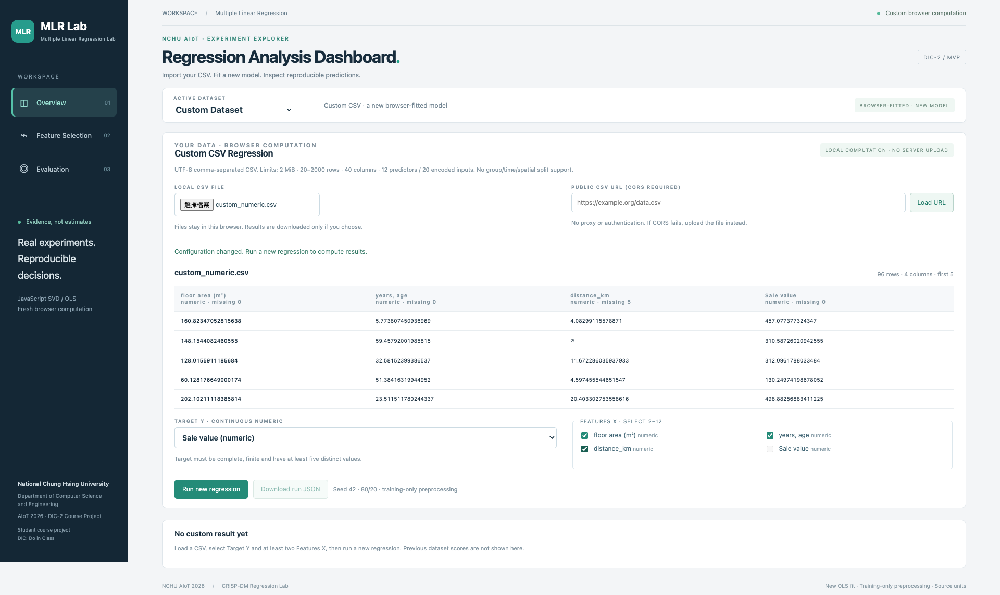
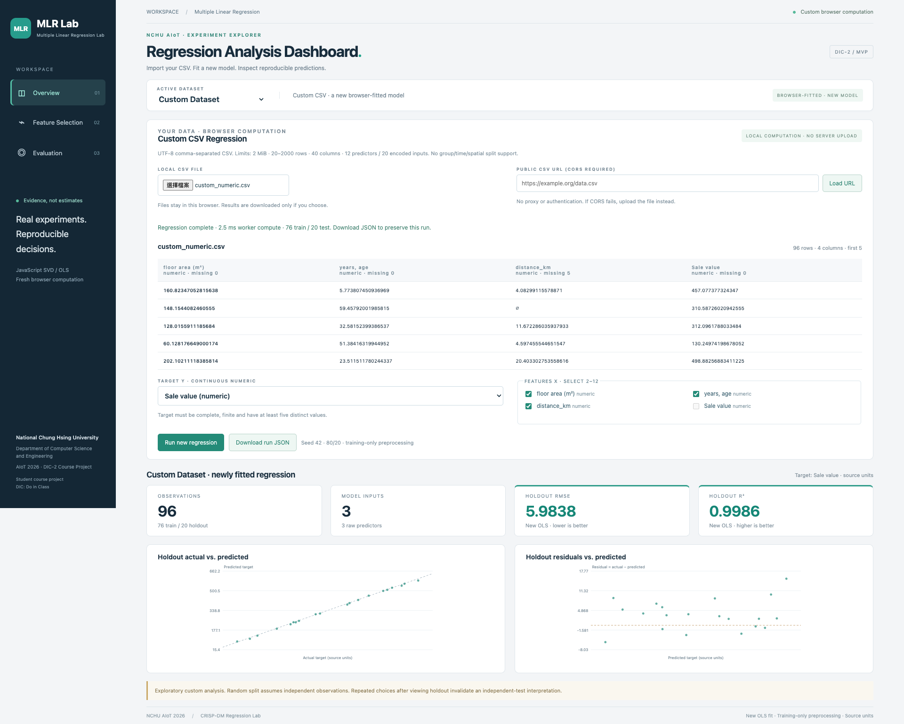

# Custom CSV Regression MVP — 實測報告

本次交付真正的 Browser Regression MVP，非五方法 Feature Selection 完整交付。ADR-0002／PR #12 保持 Proposed，未自動 Merge／關閉 Issue #7。

## 選型：單一 JavaScript 正式實作

實際在 Playwright + Google Chrome 155/macOS 上，以同一套 sklearn training-only 前處理後的矩陣，分別執行 JS SVD 與 Pyodide/sklearn。每個候選使用新 browser context，停用 HTTP cache；單次量測，數字受本機／網路影響，不宣稱通用 benchmark。PoC 隔離數值求解；正式 CSV／切分／前處理另外由核心及 E2E tests 驗證。

| 候選 | 冷載入 ms | 首次 fit/predict ms | 網路 encoded bytes | JS heap bytes（非峰值/RSS） | WASM heap bytes |
| --- | ---: | ---: | ---: | ---: | ---: |
| javascript | 4.400 | 2.200 | 83005 | 1624444 | N/A |
| pyodide | 3644.900 | 1427.400 | 30080176 | 142521360 | 163905536 |

Heap 是 browser 可見的粗略診斷，JS/WASM 可能有重疊，不相加成整體 RSS。Pyodide 0.28.3 支援 sklearn 1.7.0/numpy 2.2.5；本地 reference 是 sklearn 1.9.1/numpy 2.5.4。Pyodide 可減少未來五方法演算法重寫，但多了 WASM/runtime/network memory/worker packaging 成本；本次 Regression MVP 選 JS 的較小本地資產和可驗證 SVD。

正式只保留 ml-matrix **6.12.1** + Papa Parse **5.5.3**，連同 MIT notices／build lock；約 87 KiB vendored module，無 CDN runtime、API 或第二套正式 Pyodide。JS 必須自行驗證 split/preprocessing／數值誤差，已在測試覆蓋；不是假設與 sklearn 天然一致。

[Pyodide packages](https://pyodide.org/en/0.28.3/usage/packages-in-pyodide.html)、[ml-matrix](https://github.com/mljs/matrix)、[Papa Parse](https://github.com/mholt/PapaParse)；完整實測 [poc.json](poc.json)。

## 兩份新 CSV 分析（不是靜態分數）

50 Startups 用原 manifest pinned CSV（SHA 校驗），Profit 與四 raw X（含 State）。96-row numeric fixture 是刻意合成的測試資料，Target Sale value、三個不同名稱 X，含 quoted-comma／Unicode header 和五個缺值；不冒充真實估價資料。

| CSV | 新計算 OLS MAE | MSE | RMSE | R² | 最大預測 abs 差（vs sklearn） |
| --- | ---: | ---: | ---: | ---: | ---: |
| 50_startups | 6961.477813276 | 82010363.045013785 | 9055.957323498 | 0.898726641432 | 2.441e-07 |
| custom_numeric | 4.770169269 | 35.805576295 | 5.983776090 | 0.998557064958 | 3.411e-13 |

兩者各有重新擬合的 Mean Dummy；完整預測／殘差／係數／訓練內補值及來源 SHA 在 [50 Startups run](50_startups-browser-run.json) 與 [numeric run](custom_numeric-browser-run.json)。

固定 random_state=42、80/20，row IDs 與 sklearn 完全一致：50→40/10，96→76/20。JS 用中心／尺度後 SVD 擬合 OLS，轉回原始單位係數。所有 median/mode/categories/scales 只 fit training。PoC 最大預測誤差 JS <1e-6、Pyodide <1e-6；正式值以表中兩個完整 CSV 流程為準。

容忍範圍：prediction absolute 1e-6；metrics absolute 1e-6 + relative 1e-10。MSE 大量級另允許此相對誤差，不能把 MSE 差值直接套 RMSE 單位。每筆預測、四項指標及 Dummy 都有比對；沒有為分數改 seed／k。

## 範圍與驗證

本地已通過 9 個核心 tests、完整 CSV URL／local file → select → worker → metrics → download E2E，及內建兩資料集三頁。真正 example.com CORS 拒絕有上傳替代；預期的 CORS console 訊息獨立記錄，不冒稱瀏覽器完全沒有 error。Unexpected Console／JS errors=0。初版 route mock 未模擬 CORS 成功，已換成實際非 CORS 站點，失敗模擬不計 PASS。

Custom 五方法 ranking／k 曲線、training CV／nested CV **未實作**，UI 明確 Not Available；Feature Selection 頁僅呈現實際設計欄位，不是排名。未宣稱整個 Issue #7 全部驗收完成。

公開 Pages [browser verification](browser-verification.json)；正式 Pages 部署 Commit／Screenshot 與最終 gates 見 [驗證紀錄](VERIFICATION.md)。

[操作、限制及架構](../../CUSTOM_CSV.md)。

## 正式部署及 Screenshot

[GitHub Pages Demo](https://wupojung.github.io/AIoT-DIC2-MultipleLR/) · [成功部署紀錄](https://github.com/wupojung/AIoT-DIC2-MultipleLR/actions/runs/38928694867)

**實際部署／截圖 Web Commit：`f19dc0111c950cec140d2998adfe44d79a9e16d6`**。
後續 commit 只附證據及文件，不改此 Web。從公開網址用 Playwright + 真實 Chrome 155、1920×1080 viewport／scale 1 重新讀取 CSV、worker 擬合後 full-page capture。
無 AI 圖片、合成、mockup 或靜態 JSON 冒充分析。第二張是合成 numeric 測試 CSV 的真實系統計算，不是宣稱真實房價觀測。





Custom Feature Selection 沒有完成，所以不提供假 k 曲線 Screenshot。

## PoC 重現入口（只供開發比較，不在正式 Web 載入 Pyodide）

先依 `web/vendor/README.md` 在 `/tmp/mlr-vendor` 安裝 pinned build dependencies，再執行：

```sh
.venv/bin/python tests/generate_custom_reference.py --poc-dir /tmp/dic2-poc/www
# Create /tmp/mlr-vendor/poc-entry.js with:
# export {Matrix, SingularValueDecomposition} from 'ml-matrix';
/tmp/mlr-vendor/node_modules/.bin/esbuild /tmp/mlr-vendor/poc-entry.js --bundle --format=iife --global-name=ML --minify --outfile=/tmp/dic2-poc/www/matrix.js
python3 -m http.server 8010 --directory /tmp/dic2-poc/www
# Separate terminal:
NODE_PATH=/tmp/dic2-browser/node_modules node tests/runtime_poc.cjs
```

前處理後 PoC 矩陣只存於 temp directory，不提交原始 CSV 或發布至 Pages。不同機器／網路重新量測數字可不同，不以性能數字當研究績效。
