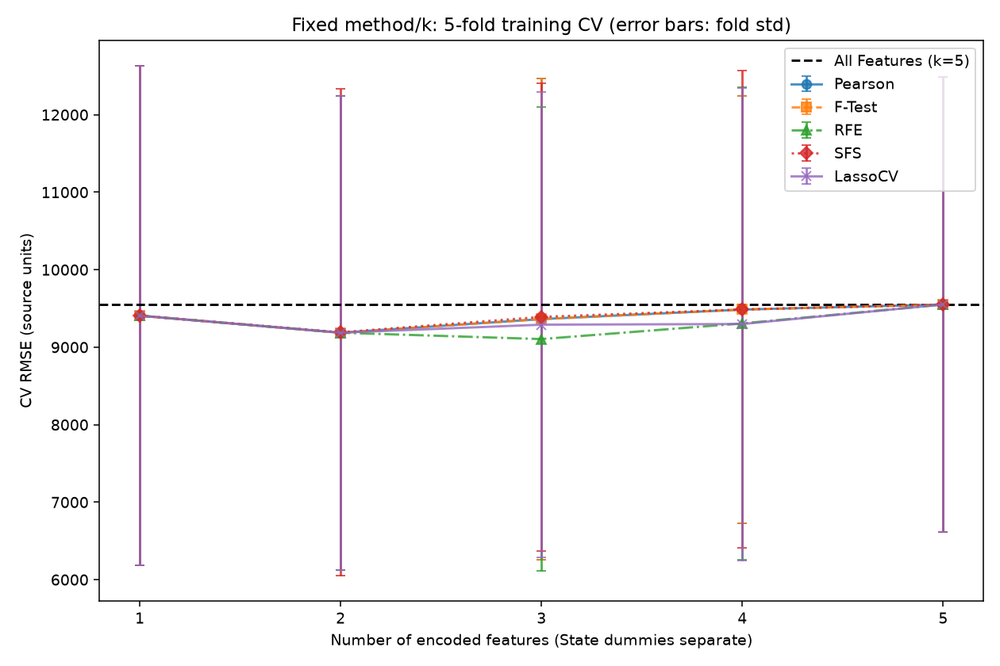
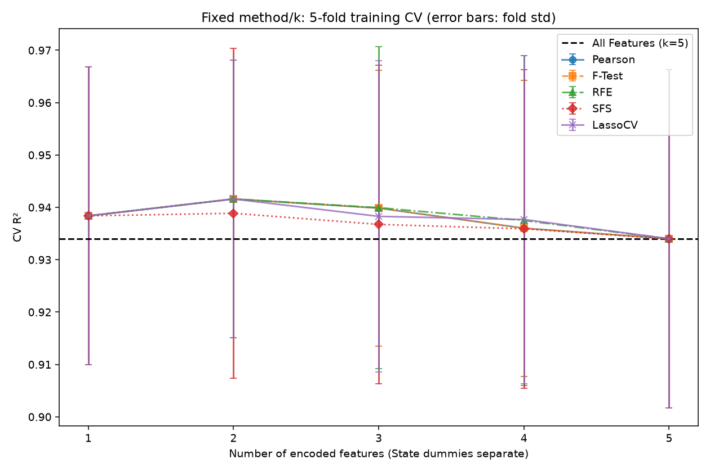

# 50 Startups 特徵選擇實測分析報告

狀態：技術驗證完成，人工審查待完成。此報告與圖表由真實執行產物生成；
Issue #3 的 Baseline／指標／圖片未覆寫。只使用原 40 筆 train，不再評估已公開過的 holdout。

## 方法與資料

沿用原 manifest、seed 42、80/20 和五折。五種 selector 每折重新擬合，
最後預測皆為 LinearRegression。State 的兩個 dummy 分開計算 k，
k=5 是三個數值欄 + Florida／New York，而非五個原始欄位。
前處理／SFS／alpha 的三折計算全部在對應 training 範圍；
細節、alpha grid、資料 block 隔離與同分規則見 [實驗協定](../../FEATURE_SELECTION_PROTOCOL.md)。

## 五折比較表與曲線

每列是固定方法／k 的五個 validation fold，± 為 ddof=0 的 fold std；
誤差使用來源數值單位（幣別、期間未知），R² 無單位。
每折的特徵集合可不同，不是先用全部 train 排名再交叉驗證。

| 方法 | k | CV RMSE mean ± std | CV R² mean ± std |
| --- | --- | --- | --- |
| All Features | 5 | 9550.676 ± 2936.123 | 0.934004 ± 0.032301 |
| F-Test | 1 | 9406.579 ± 3224.414 | 0.938374 ± 0.028423 |
| F-Test | 2 | 9186.680 ± 3058.888 | 0.941600 ± 0.026494 |
| F-Test | 3 | 9362.472 ± 3109.087 | 0.939857 ± 0.026346 |
| F-Test | 4 | 9485.354 ± 2753.779 | 0.936019 ± 0.028270 |
| F-Test | 5 | 9550.676 ± 2936.123 | 0.934004 ± 0.032301 |
| LassoCV | 1 | 9406.579 ± 3224.414 | 0.938374 ± 0.028423 |
| LassoCV | 2 | 9186.680 ± 3058.888 | 0.941600 ± 0.026494 |
| LassoCV | 3 | 9290.414 ± 2999.671 | 0.938277 ± 0.029702 |
| LassoCV | 4 | 9298.995 ± 3049.504 | 0.937683 ± 0.031323 |
| LassoCV | 5 | 9550.676 ± 2936.123 | 0.934004 ± 0.032301 |
| Pearson | 1 | 9406.579 ± 3224.414 | 0.938374 ± 0.028423 |
| Pearson | 2 | 9186.680 ± 3058.888 | 0.941600 ± 0.026494 |
| Pearson | 3 | 9362.472 ± 3109.087 | 0.939857 ± 0.026346 |
| Pearson | 4 | 9485.354 ± 2753.779 | 0.936019 ± 0.028270 |
| Pearson | 5 | 9550.676 ± 2936.123 | 0.934004 ± 0.032301 |
| RFE | 1 | 9406.579 ± 3224.414 | 0.938374 ± 0.028423 |
| RFE | 2 | 9186.680 ± 3058.888 | 0.941600 ± 0.026494 |
| RFE | 3 | 9104.681 ± 2991.936 | 0.939939 ± 0.030751 |
| RFE | 4 | 9306.786 ± 3045.596 | 0.937497 ± 0.031502 |
| RFE | 5 | 9550.676 ± 2936.123 | 0.934004 ± 0.032301 |
| SFS | 1 | 9406.579 ± 3224.414 | 0.938374 ± 0.028423 |
| SFS | 2 | 9192.038 ± 3139.349 | 0.938874 ± 0.031497 |
| SFS | 3 | 9390.427 ± 3017.002 | 0.936745 ± 0.030455 |
| SFS | 4 | 9486.308 ± 3080.623 | 0.935902 ± 0.030398 |
| SFS | 5 | 9550.676 ± 2936.123 | 0.934004 ± 0.032301 |





### 曲線的最低點（描述性比較）

- Pearson：最低平均 RMSE 的 k=2，RMSE=9186.680，R²=0.941600。
- F-Test：最低平均 RMSE 的 k=2，RMSE=9186.680，R²=0.941600。
- RFE：最低平均 RMSE 的 k=3，RMSE=9104.681，R²=0.939939。
- SFS：最低平均 RMSE 的 k=2，RMSE=9192.038，R²=0.938874。
- LassoCV：最低平均 RMSE 的 k=2，RMSE=9186.680，R²=0.941600。

Pearson 與單變量 F-test 在此得到等價排序；曲線相同有數學理由，並非共用固定假排名。
RFE 逐步重 fit 刪欄；SFS 每步對剩餘候選重算內折表現，所以局部路徑可不同。
Lasso 依標準化係數排序，對正則化強度與共線性敏感。
不同 k 的 R² 和 RMSE 最佳點不一定相同；規則預先以 mean RMSE 選擇，不事後換指標。

## 全部 40 train 的實際順序與每個 k 集合

此表用於解釋最終重擬合，不可拿它代替每折選擇。RFE 順序是反向淘汰優先序；
SFS 是實際 greedy 加入順序，其他方法是分數／絕對係數排序。

| 方法 | k | 特徵（依該方法順序） |
| --- | --- | --- |
| Pearson | 1 | `numeric__R&D Spend` |
| Pearson | 2 | `numeric__R&D Spend` → `numeric__Marketing Spend` |
| Pearson | 3 | `numeric__R&D Spend` → `numeric__Marketing Spend` → `state__State_New York` |
| Pearson | 4 | `numeric__R&D Spend` → `numeric__Marketing Spend` → `state__State_New York` → `state__State_Florida` |
| Pearson | 5 | `numeric__R&D Spend` → `numeric__Marketing Spend` → `state__State_New York` → `state__State_Florida` → `numeric__Administration` |
| F-Test | 1 | `numeric__R&D Spend` |
| F-Test | 2 | `numeric__R&D Spend` → `numeric__Marketing Spend` |
| F-Test | 3 | `numeric__R&D Spend` → `numeric__Marketing Spend` → `state__State_New York` |
| F-Test | 4 | `numeric__R&D Spend` → `numeric__Marketing Spend` → `state__State_New York` → `state__State_Florida` |
| F-Test | 5 | `numeric__R&D Spend` → `numeric__Marketing Spend` → `state__State_New York` → `state__State_Florida` → `numeric__Administration` |
| RFE | 1 | `numeric__R&D Spend` |
| RFE | 2 | `numeric__R&D Spend` → `numeric__Marketing Spend` |
| RFE | 3 | `numeric__R&D Spend` → `numeric__Marketing Spend` → `numeric__Administration` |
| RFE | 4 | `numeric__R&D Spend` → `numeric__Marketing Spend` → `numeric__Administration` → `state__State_Florida` |
| RFE | 5 | `numeric__R&D Spend` → `numeric__Marketing Spend` → `numeric__Administration` → `state__State_Florida` → `state__State_New York` |
| SFS | 1 | `numeric__R&D Spend` |
| SFS | 2 | `numeric__R&D Spend` → `numeric__Marketing Spend` |
| SFS | 3 | `numeric__R&D Spend` → `numeric__Marketing Spend` → `numeric__Administration` |
| SFS | 4 | `numeric__R&D Spend` → `numeric__Marketing Spend` → `numeric__Administration` → `state__State_Florida` |
| SFS | 5 | `numeric__R&D Spend` → `numeric__Marketing Spend` → `numeric__Administration` → `state__State_Florida` → `state__State_New York` |
| LassoCV | 1 | `numeric__R&D Spend` |
| LassoCV | 2 | `numeric__R&D Spend` → `numeric__Marketing Spend` |
| LassoCV | 3 | `numeric__R&D Spend` → `numeric__Marketing Spend` → `numeric__Administration` |
| LassoCV | 4 | `numeric__R&D Spend` → `numeric__Marketing Spend` → `numeric__Administration` → `state__State_Florida` |
| LassoCV | 5 | `numeric__R&D Spend` → `numeric__Marketing Spend` → `numeric__Administration` → `state__State_Florida` → `state__State_New York` |

LassoCV 在完整 train 的真實最佳 alpha=1778.27941004，以 21 個預定 alpha 的三折 mean MSE 選出。

| Lasso 標準化欄位 | 實測係數 |
| --- | --- |
| `numeric__R&D Spend` | 36031.412996670 |
| `numeric__Administration` | -0.000000000 |
| `numeric__Marketing Spend` | 3432.267688002 |
| `state__State_Florida` | 0.000000000 |
| `state__State_New York` | -0.000000000 |

零係數欄：`numeric__Administration`、`state__State_Florida`、`state__State_New York`。
這些欄位在高 k 時僅按明訂字典序補入，不代表 Lasso 判定它們有非零貢獻。
[完整 600 組每折／方法／k 子集與順序](selected_features.csv)；
[真實選擇器 trace、SFS 候選分數、alpha path 與 fit audit](results.json)。

## 巢狀驗證與最終凍結方案

曲線最低點經過 26 候選比較，有選擇偏差；另外用外五折／內三折評估整個選模程序。
各外折只憑自己的 training 內折選方法／k，再評分外折 validation：

| 外折 | 內折勝者 | k | 外折 RMSE | 外折 R² |
| --- | --- | --- | --- | --- |
| outer0 | F-Test | 2 | 9122.839 | 0.960052 |
| outer1 | F-Test | 2 | 9019.769 | 0.951789 |
| outer2 | LassoCV | 3 | 14666.104 | 0.896596 |
| outer3 | LassoCV | 3 | 5723.698 | 0.974645 |
| outer4 | LassoCV | 3 | 7654.383 | 0.910163 |

整個選模程序的 nested RMSE=9237.359 ± 2979.374，
nested R²=0.938649 ± 0.030021。

全部 40 train 依相同內三折規則凍結的方案為 **F-Test，k=3**；
選擇用 CV RMSE=9453.571（這是選擇分數，不是無偏的新 test 指標）。

特徵：`numeric__R&D Spend`、`numeric__Marketing Spend`、`state__State_New York`。

完整 train 的三折選模和五折曲線描述性最低點可能不同，這正反映小樣本／切分不確定性；
不事後改採較好看的曲線勝者。[最終三折候選表](final_selection.csv)、
[凍結方案與 protocol hash](frozen_selection.json)。本次 holdout_evaluations=0。

## 驗證證據與限制

Verifier 由 6240 筆 training-only 預測重算四指標，重新擬合各候選 OLS，
驗全部 fit/split、600 組子集與 nested 決策；逐 alpha 的獨立 Lasso 重算
確認全部 24 組 LassoCV path。從已驗 CSV 重畫圖並比對 PNG bytes。
測試另更動整個 holdout X/y，要求結果、選擇、audit、圖表完全不變。
All Features CV 與原 Baseline regression tests 持續比較。

最小內層 training 約 14 筆，fold std 不是信賴區間；只一組切分不足以證明方法顯著勝出。
原 Baseline holdout 已曝光，無法稱為新的未見 test。樣本來源、資料專屬權利、
幣別／期間、企業獨立性仍有限制；不能作因果解釋或現實獲利建議。

教師範例 [README（固定版本）](https://github.com/huanchen1107/AIoT-DIC2-MultipleLR/blob/8b65e3bd9745e650ae7bea28f9562c059d5029ed/README.md)
展示的演算法組合與以 test 呈現 k 曲線不同；本期依 Issue #4 五方法、training CV／nested、同下游 OLS，
不複製教師分數或預設最佳 k。舊 [DIC-2_test](https://github.com/wupojung/DIC-2_test/blob/969ae66465ddb815dab76a29c887207cf4885843/feature_selection.py)
中的固定 RFE 路徑、以固定排序當 SFS、固定 k=2 標記、seed=0 與 mixed Lasso/RandomForest
預測等做法均不沿用；第五欄直接由 encoder 名稱與真正選擇結果取得。

## 重現

```sh
python python/src/feature_selection.py --run-id fs-v1
python python/src/verify_feature_selection.py outputs/50_startups/feature_selection/fs-v1 --source data/50_startups/50_Startups.csv --replay-lasso
python python/src/report_feature_selection.py outputs/50_startups/feature_selection/fs-v1 --output-dir /tmp/fs-review
python -m unittest discover -s tests -v
```

首次需固定來源 CSV 或已驗證 cache；run-id 與報告目錄都拒絕覆寫。
沒有修改已接受 ADR、Baseline、Web 整合或部署；等待人工審查，不自動 Merge／close Issue。
